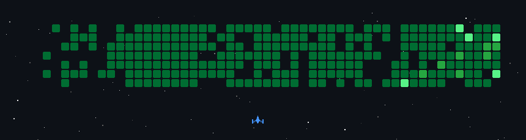

<h1 align="center">Sudharsan S</h1>

  

  

---

## Technologies I Build With

<table align="center">
  <tr>
    <td align="center" valign="middle" width="126" height="106">
       Python
    </td>
    <td align="center" valign="middle" width="126" height="106">
       JavaScript
    </td>
    <td align="center" valign="middle" width="126" height="106">
       TypeScript
    </td>
    <td align="center" valign="middle" width="126" height="106">
       React
    </td>
    <td align="center" valign="middle" width="126" height="106">
      <picture>
        <source media="(prefers-color-scheme: dark)" srcset="https://cdn.simpleicons.org/nextdotjs/ffffff" />
        <source media="(prefers-color-scheme: light)" srcset="https://cdn.simpleicons.org/nextdotjs/000000" />
        
      </picture> Next.js
    </td>
    <td align="center" valign="middle" width="126" height="106">
       Node.js
    </td>
    <td align="center" valign="middle" width="126" height="106">
      <picture>
        <source media="(prefers-color-scheme: dark)" srcset="https://cdn.simpleicons.org/express/ffffff" />
        <source media="(prefers-color-scheme: light)" srcset="https://cdn.simpleicons.org/express/000000" />
        
      </picture> Express
    </td>
  </tr>
  <tr>
    <td align="center" valign="middle" width="126" height="106">
       Bash
    </td>
    <td align="center" valign="middle" width="126" height="106">
       PyTorch
    </td>
    <td align="center" valign="middle" width="126" height="106">
       TensorFlow
    </td>
    <td align="center" valign="middle" width="126" height="106">
      <picture>
        <source media="(prefers-color-scheme: dark)" srcset="https://cdn.jsdelivr.net/gh/glincker/thesvg@main/public/icons/openai/dark.svg" />
        <source media="(prefers-color-scheme: light)" srcset="https://cdn.jsdelivr.net/gh/glincker/thesvg@main/public/icons/openai/default.svg" />
        
      </picture> OpenAI
    </td>
    <td align="center" valign="middle" width="126" height="106">
       Hugging Face
    </td>
    <td align="center" valign="middle" width="126" height="106">
       LangChain
    </td>
    <td align="center" valign="middle" width="126" height="106">
       LangGraph
    </td>
  </tr>
  <tr>
    <td align="center" valign="middle" width="126" height="106">
      <picture>
        <source media="(prefers-color-scheme: dark)" srcset="https://cdn.simpleicons.org/modelcontextprotocol/ffffff" />
        <source media="(prefers-color-scheme: light)" srcset="https://cdn.simpleicons.org/modelcontextprotocol/000000" />
        
      </picture> MCP
    </td>
    <td align="center" valign="middle" width="126" height="106">
       vLLM
    </td>
    <td align="center" valign="middle" width="126" height="106">
      <picture>
        <source media="(prefers-color-scheme: dark)" srcset="https://cdn.simpleicons.org/ollama/ffffff" />
        <source media="(prefers-color-scheme: light)" srcset="https://cdn.simpleicons.org/ollama/000000" />
        
      </picture> Ollama
    </td>
    <td align="center" valign="middle" width="126" height="106">
       NVIDIA CUDA
    </td>
    <td align="center" valign="middle" width="126" height="106">
      <picture>
        <source media="(prefers-color-scheme: dark)" srcset="https://cdn.simpleicons.org/jinja/E04848" />
        <source media="(prefers-color-scheme: light)" srcset="https://cdn.simpleicons.org/jinja/B41717" />
        
      </picture> Jinja2
    </td>
    <td align="center" valign="middle" width="126" height="106">
       NumPy
    </td>
    <td align="center" valign="middle" width="126" height="106">
       Pandas
    </td>
  </tr>
  <tr>
    <td align="center" valign="middle" width="126" height="106">
       Matplotlib
    </td>
    <td align="center" valign="middle" width="126" height="106">
       OpenCV
    </td>
    <td align="center" valign="middle" width="126" height="106">
       Jupyter
    </td>
    <td align="center" valign="middle" width="126" height="106">
       PostgreSQL
    </td>
    <td align="center" valign="middle" width="126" height="106">
       MongoDB
    </td>
    <td align="center" valign="middle" width="126" height="106">
       Redis
    </td>
    <td align="center" valign="middle" width="126" height="106">
       Qdrant
    </td>
  </tr>
  <tr>
    <td align="center" valign="middle" width="126" height="106">
      <picture>
        <source media="(prefers-color-scheme: dark)" srcset="https://cdn.simpleicons.org/apachekafka/ffffff" />
        <source media="(prefers-color-scheme: light)" srcset="https://cdn.simpleicons.org/apachekafka/231F20" />
        
      </picture> Apache Kafka
    </td>
    <td align="center" valign="middle" width="126" height="106">
       RabbitMQ
    </td>
    <td align="center" valign="middle" width="126" height="106">
       Elasticsearch
    </td>
    <td align="center" valign="middle" width="126" height="106">
       FastAPI
    </td>
    <td align="center" valign="middle" width="126" height="106">
       GraphQL
    </td>
    <td align="center" valign="middle" width="126" height="106">
       Nginx
    </td>
    <td align="center" valign="middle" width="126" height="106">
      <picture>
        <source media="(prefers-color-scheme: dark)" srcset="https://cdn.jsdelivr.net/gh/homarr-labs/dashboard-icons/svg/aws-light.svg" />
        <source media="(prefers-color-scheme: light)" srcset="https://cdn.jsdelivr.net/gh/homarr-labs/dashboard-icons/svg/aws.svg" />
        
      </picture> AWS
    </td>
  </tr>
  <tr>
    <td align="center" valign="middle" width="126" height="106">
       Google Cloud
    </td>
    <td align="center" valign="middle" width="126" height="106">
       Microsoft Azure
    </td>
    <td align="center" valign="middle" width="126" height="106">
      <picture>
        <source media="(prefers-color-scheme: dark)" srcset="https://cdn.jsdelivr.net/gh/homarr-labs/dashboard-icons/svg/runpod.svg" />
        <source media="(prefers-color-scheme: light)" srcset="https://cdn.jsdelivr.net/gh/homarr-labs/dashboard-icons/svg/runpod-light.svg" />
        
      </picture> RunPod
    </td>
    <td align="center" valign="middle" width="126" height="106">
       Docker
    </td>
    <td align="center" valign="middle" width="126" height="106">
       Kubernetes
    </td>
    <td align="center" valign="middle" width="126" height="106">
       Terraform
    </td>
    <td align="center" valign="middle" width="126" height="106">
       Linux
    </td>
  </tr>
  <tr>
    <td align="center" valign="middle" width="126" height="106">
       Cloudflare
    </td>
    <td align="center" valign="middle" width="126" height="106">
       Raspberry Pi
    </td>
    <td align="center" valign="middle" width="126" height="106">
       Arduino
    </td>
    <td align="center" valign="middle" width="126" height="106">
       Git
    </td>
    <td align="center" valign="middle" width="126" height="106">
       GitHub Actions
    </td>
    <td align="center" valign="middle" width="126" height="106">
       GitLab
    </td>
    <td align="center" valign="middle" width="126" height="106">
       Jenkins
    </td>
  </tr>
  <tr>
    <td align="center" valign="middle" width="126" height="106">
       Ansible
    </td>
    <td align="center" valign="middle" width="126" height="106">
       Prometheus
    </td>
    <td align="center" valign="middle" width="126" height="106">
       Grafana
    </td>
    <td align="center" valign="middle" width="126" height="106">
       Selenium
    </td>
    <td align="center" valign="middle" width="126" height="106">
       Playwright
    </td>
    <td align="center" valign="middle" width="126" height="106">
       CodeRabbit
    </td>
    <td align="center" valign="middle" width="126" height="106">
       Apache Spark
    </td>
  </tr>
</table>

---
## Achievements & Events

| Event | Outcome | Prize / Recognition |
|-------|---------|---------------------|
| **PSB CyberShield National Hackathon 2026** | Top 9 / 2,986 teams — Grand Finale at IIT Hyderabad | Bank of India · IIT Hyderabad · Indian Ministry of Finance |
| **Smart India Hackathon 2025** | National Winner — first SRMIST Trichy team in 5 years | ₹1,50,000 |
| **Amazon ML Challenge 2025** | AIR 62 / 6,223 teams | All-India Rank |
| **Edu Tantr 12-Hour Hackathon** | Top 5 / 981 teams — National Finalist | Internship Offer |
| **DigiGreen National Hackathon** | 4th Place / 556+ teams | Certificate of Recognition |
| **ProtoThon 1.0 – SRM IST** | Winner | ₹5,000 |
| **Algo Vault – YUVA Techfest** | Winner | ₹5,000 |
| **ICETETM'25 – International Conference** | Research Paper Presented | International |
| **INNOV FEST '24 – SRM IST** | Project Deployment | Institutional |
| **HackXtreme 2025** | 24-Hour Hackathon | Participation |

---

## Experience

<table align="center">
  <thead>
    <tr>
      <th align="left">Role</th>
      <th align="left">Company / Location</th>
      <th align="left">Duration</th>
      <th align="left">Work Mode</th>
    </tr>
  </thead>
  <tbody>
    <tr>
      <td align="left" valign="middle"><strong>AI/LLM Engineer</strong></td>
      <td align="left" valign="middle">Times Media SDN BHD, Malaysia &nbsp;</td>
      <td align="left" valign="middle"><small>&#9679;&nbsp;<strong>Oct&nbsp;2026&nbsp;–&nbsp;Present</strong></small></td>
      <td align="left" valign="middle"><small>Remote</small></td>
    </tr>
    <tr>
      <td align="left" valign="middle"><strong>AI Engineer</strong></td>
      <td align="left" valign="middle">Hooman Digital, Kolkata</td>
      <td align="left" valign="middle"><small>Jun&nbsp;2026&nbsp;–&nbsp;Sep&nbsp;2026</small></td>
      <td align="left" valign="middle"><small>Full&#8209;time</small></td>
    </tr>
    <tr>
      <td align="left" valign="middle"><strong>ML Engineer Intern</strong></td>
      <td align="left" valign="middle">ALKF, Hong Kong &nbsp;</td>
      <td align="left" valign="middle"><small>Jan&nbsp;2026&nbsp;–&nbsp;Apr&nbsp;2026</small></td>
      <td align="left" valign="middle"><small>Remote</small></td>
    </tr>
    <tr>
      <td align="left" valign="middle"><strong>Quantum Computation Intern</strong></td>
      <td align="left" valign="middle">NIT Trichy</td>
      <td align="left" valign="middle"><small>Jun&nbsp;2025&nbsp;–&nbsp;Jul&nbsp;2025</small></td>
      <td align="left" valign="middle"><small>On&#8209;site</small></td>
    </tr>
    <tr>
      <td align="left" valign="middle"><strong>Robotics Software Engineer</strong></td>
      <td align="left" valign="middle">Persist Ventures, San Francisco &nbsp;</td>
      <td align="left" valign="middle"><small>Dec&nbsp;2024&nbsp;–&nbsp;Feb&nbsp;2025</small></td>
      <td align="left" valign="middle"><small>Remote</small></td>
    </tr>
    <tr>
      <td align="left" valign="middle"><strong>Data Analyst</strong></td>
      <td align="left" valign="middle">Indika AI, Bengaluru</td>
      <td align="left" valign="middle"><small>Jul&nbsp;2024&nbsp;–&nbsp;Sep&nbsp;2024</small></td>
      <td align="left" valign="middle"><small>Remote</small></td>
    </tr>
  </tbody>
</table>

---

## GitHub Statistics

  

  
  
  
  

---

